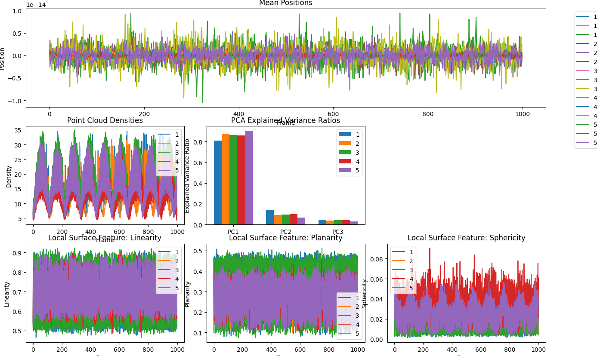
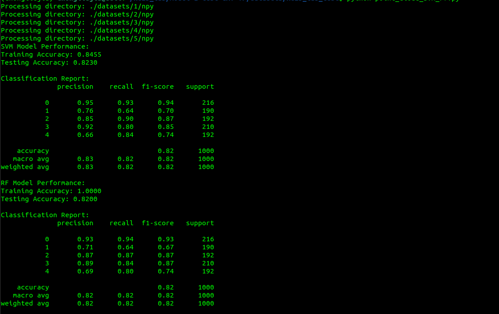

# LiDAR Point Cloud Machine Learning

Undergraduate research project at Iowa State University exploring geometric feature extraction and supervised learning on LiDAR object point clouds.

## Project Work

- Centered and analyzed 5,000 LiDAR object point-cloud frames (about 1.97 million points) from five source folders, 1,000 frames per folder
- Computed 8 geometric features per frame: k-nearest-neighbor density (mean and standard deviation), eigenvalue-based linearity, planarity, and sphericity, and PCA explained-variance ratios (PC1 to PC3)
- Trained SVM and random forest classifiers to predict which source folder a frame came from (5 classes), reaching about 82% test accuracy on a random 20% hold-out
- Began a voxel-based 3D ResNet classifier in PyTorch; this prototype was never trained

## Repository Structure

```text
lidar-point-cloud-ml/
├── datasets/                     # Research datasets; excluded from version control
├── figures/                  # Analysis and experiment figures
├── src/
│   ├── analyze_stats.py
│   ├── classification.py
│   └── point_cloud_svm_rf.py
├── .gitignore
├── README.md
└── requirements.txt
```

## Setup

Create a virtual environment and install the dependencies:

```bash
python -m venv .venv
source .venv/Scripts/activate
python -m pip install -r requirements.txt
```

## Analysis Scripts

Run the scripts from the repository root; they read data from `./datasets`.

Per-frame statistics (centroid-centered positions, density, PCA, local surface features) with a comparison plot across the five folders:

```bash
python src/analyze_stats.py
```

Feature extraction plus SVM and random forest classification, with printed classification reports and a random forest feature-importance plot:

```bash
python src/point_cloud_svm_rf.py
```

`src/classification.py` is an unfinished prototype of a voxel-based 3D ResNet. It does not currently run: its main block references an undefined variable, the training code is commented out, and its labels are placeholders.

## Results



Figure 1: Per-frame density, PCA explained-variance ratios, and local surface features (linearity, planarity, sphericity) across the five source folders.


Figure 2: Random forest feature importances. The eigenvalue-based shape features (sphericity, planarity, linearity) rank highest.



Figure 3: Terminal output from `point_cloud_svm_rf.py` on 5,000 frames, with 1,000 held out for testing.

| Model | Train accuracy | Test accuracy |
| --- | --- | --- |
| SVM (RBF kernel) | 0.8455 | 0.8230 |
| Random forest | 1.0000 | 0.8200 |

## Limitations

- Classification labels are source folders, not object categories. What the five folders represent is not documented.
- The train/test split is random across consecutive frames, which are strongly correlated (see Figure 1), so test accuracy is likely optimistic.
- The random forest fits the training data perfectly, which indicates overfitting.
- Results are recorded only as the figures above; no run logs or trained models were saved.
- Dependencies in `requirements.txt` are not pinned.

## Data Availability

The dataset is not included in this repository. The scripts expect pre-extracted object point clouds saved as NumPy arrays of shape `(N, 3)` at `datasets/<1-5>/npy/<frame>_objects.npy`, with frames numbered `000000` onward. The raw LiDAR data and the code that produced these per-frame files are not part of this repository.

## Acknowledgments

This work was carried out at Iowa State University under the supervision of Dr. Chenglin Miao, working closely with PhD student Zihao Liu.

## Status

Archived undergraduate research project, kept for documentation. It cannot be reproduced without the dataset.
