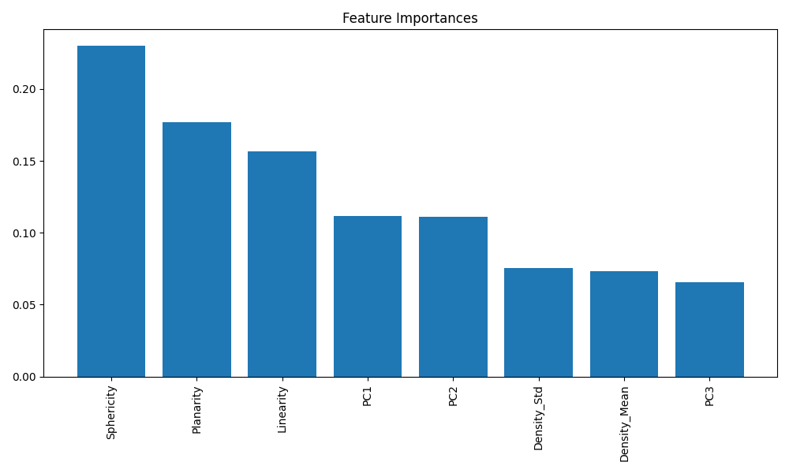

# LiDAR Point Cloud Machine Learning

Undergraduate research project at Iowa State University exploring geometric feature extraction and supervised learning on LiDAR object point clouds.

## Project Work

- Centered and analyzed 5,000 LiDAR object point-cloud frames containing about 1.97 million points. The source data has 5,005 frames available (1,001 in each of five folders); the scripts analyze the first 1,000 frames of each folder.
- Computed 8 geometric features per frame:
  - Point density: mean and standard deviation of each point's neighbor count within a fixed radius (0.1)
  - Local shape: linearity, planarity, and sphericity from the covariance eigenvalues of each point's 10 nearest neighbors, averaged over the frame
  - Global shape: PCA explained-variance ratios (PC1 to PC3)
- Trained SVM and random forest classifiers to predict each frame's source-folder label (5 classes), reaching 82.3% (SVM) and 82.0% (random forest) accuracy on a random 1,000-frame test split
- Started a voxel-based 3D ResNet classifier in PyTorch; it is an unfinished, untrained prototype

## Repository Structure

```text
lidar-point-cloud-ml/
├── datasets/                     # Research datasets; excluded from version control
├── figures/                  # Analysis and experiment figures
├── src/
│   ├── analyze_stats.py
│   ├── classification.py     # Unfinished, untrained 3D ResNet prototype (not runnable)
│   └── point_cloud_svm_rf.py
├── .gitignore
├── README.md
└── requirements.txt
```

## Setup

Create a virtual environment and install the dependencies:

```bash
python -m venv .venv
source .venv/Scripts/activate
python -m pip install -r requirements.txt
```

## Analysis Scripts

Run the scripts from the repository root; they read data from `./datasets`. Each script analyzes frames `000000` to `000999` in each of the five folders.

Per-frame statistics (centroid-centered positions, fixed-radius density, PCA, 10-nearest-neighbor surface features) with a comparison plot across the five folders:

```bash
python src/analyze_stats.py
```

Feature extraction plus SVM and random forest classification, with printed classification reports and a random forest feature-importance plot:

```bash
python src/point_cloud_svm_rf.py
```

### Unfinished prototype

`src/classification.py` contains an unfinished, untrained prototype of a voxel-based 3D ResNet. It is not runnable: its main block references an undefined variable, the training code is commented out, and its labels are placeholders. No results come from it.

## Results


Figure 1: Per-frame density, PCA explained-variance ratios, and local surface features (linearity, planarity, sphericity) across the five source folders.



Figure 2: Random forest feature importances. The eigenvalue-based shape features (sphericity, planarity, linearity) rank highest.


Figure 3: Terminal output from `point_cloud_svm_rf.py` on the 5,000 analyzed frames, evaluated on a random 1,000-frame test split. The prediction target is each frame's source-folder label.

| Model | Train accuracy | Test accuracy |
| --- | --- | --- |
| SVM (RBF kernel) | 84.55% | 82.30% |
| Random forest | 100.00% | 82.00% |

## Limitations

- The models predict source-folder labels, not object categories. What the five folders represent is not documented.
- The 1,000-frame test split is drawn at random, so nearby frames, which may be correlated, can fall in both the training and test sets. This evaluation does not establish generalization to new scenes.
- The random forest fits the training data perfectly, which indicates overfitting.
- Results are recorded only as the figures above; no run logs or trained models were saved.
- Dependencies in `requirements.txt` are not pinned.

## Data Availability

The dataset is not included in this repository. The scripts expect pre-extracted object point clouds saved as NumPy arrays of shape `(N, 3)` at `datasets/<1-5>/npy/<frame>_objects.npy`, with frames numbered `000000` onward. The raw LiDAR data and the code that produced these per-frame files are not part of this repository.

## Acknowledgments

This work was carried out at Iowa State University under the supervision of Dr. Chenglin Miao, working closely with PhD student Zihao Liu.

## Status

Archived undergraduate research project, kept for documentation. It cannot be reproduced without the dataset.
